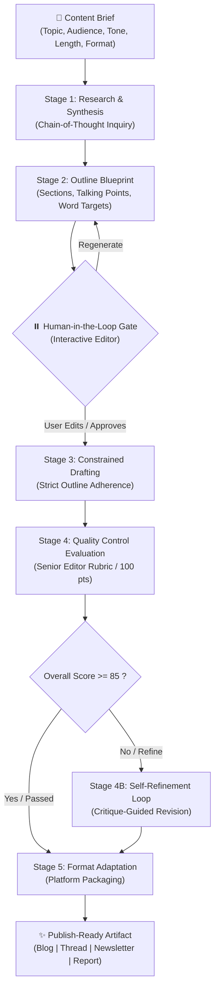

# Project 8: Content Generation Pipeline

[](https://python.org)
[](https://streamlit.io)
[](https://langchain.com)
[](https://ollama.com)
[](https://openai.com)

A production-grade, multi-stage AI content generation pipeline built with **LangChain (LCEL)** and **Streamlit**. The system takes a content brief and orchestrates automated stages of research, outlining, drafting, editorial quality control, and platform-specific formatting—featuring human-in-the-loop governance and automated self-refinement.

Supports both **Local Open-Weight Models (Ollama with `qwen2.5:3b`)** for complete data privacy and zero marginal cost, and **Cloud Frontier Models (OpenAI `gpt-4o`, `gpt-4o-mini`, or custom endpoints)**.

---

## 📑 Table of Contents

1. [Core Features &amp; Highlights](#-core-features--highlights)
2. [Pipeline Architecture](#-pipeline-architecture)
3. [The 5 Pipeline Stages](#-the-5-pipeline-stages)
4. [Quality Control &amp; The Evaluator-Optimizer Loop](#-quality-control--the-evaluator-optimizer-loop)
5. [Model Providers: Local Ollama &amp; Cloud](#-model-providers-local-ollama--cloud)
6. [Supported Output Formats](#-supported-output-formats)
7. [Installation &amp; Quickstart](#-installation--quickstart)
8. [Running the CLI Test Runner](#-running-the-cli-test-runner)
9. [Pre-Generated Sample Outputs](#-pre-generated-sample-outputs)
10. [5-7 Minute Presentation Deck](#-5-7-minute-presentation-deck)
11. [Project Directory Layout](#-project-directory-layout)

---

## 🚀 Core Features & Highlights

- **Multi-Stage LCEL Pipeline**: Chained LLM operations where each stage focuses on a single cognitive task, eliminating attention degradation and generic outputs.
- **Human-in-the-Loop Outline Gate**: The pipeline pauses after outline generation, enabling a human editor to review, edit, or reorder sections in the Streamlit UI before drafting commences.
- **Automated Senior Editor Rubric (0-100 pts)**: Evaluates drafts across 5 distinct dimensions (Grammar, Clarity, Tone, Outline Adherence, and Factuality/Depth).
- **Self-Healing Refinement Loop**: Drafts falling below the quality threshold automatically enter an editorial polish loop that addresses specific critique items.
- **Local Ollama Integration**: Native, zero-setup support for **`qwen2.5:3b`** on local hardware (Mac, Linux, Windows), delivering 100% data sovereignty and zero API expenses.
- **Cloud API & Custom Endpoint Support**: One-click switching to OpenAI (`gpt-4o`, `gpt-4o-mini`), Groq, DeepSeek, or OpenRouter.
- **Multi-Format Packaging**: Decoupled styling transforms the polished narrative into:
  - **SEO-Optimized Blog Post** (H1/H2/H3, meta description, pull quotes, image prompts)
  - **Social Media Thread** (8 numbered posts, whitespace, emojis, hashtags)
  - **Email Newsletter** (3 subject line options, preview text, TL;DR box, sign-off)
  - **Executive Report** (C-suite header, Executive Summary, Recommendations Matrix)
- **Built-in Presentation Deck (5-7 Mins)**: Interactive slide deck with presenter notes and timing cues embedded directly inside the Streamlit app.

---

## 🏗️ Pipeline Architecture



---

## 🔬 The 5 Pipeline Stages

### Stage 1: Domain Research & Chain-of-Thought Inquiry

- Deconstructs the topic from first principles.
- Analyzes target audience psychological drivers and pain points.
- Identifies 4–6 substantive conceptual pillars, verifiable data angles, and counter-arguments.

### Stage 2: Structural Outline Blueprint (With Human Gate)

- Generates working title options, opening hook strategy, and section-by-section breakdown with estimated word counts and evidence points.
- **Human Gate**: Pauses pipeline execution in Streamlit. The editor inspects, adjusts sections, or adds custom talking points, and clicks **"Approve Outline & Continue"**.

### Stage 3: Constrained Draft Generation

- Expands the narrative following the approved outline faithfully.
- Implements tone calibration and weaves in keywords naturally without filler.

### Stage 4: Automated Senior Editorial Quality Control

- Evaluates the draft on a 100-point rubric across 5 dimensions.
- Employs an **Evaluator-Optimizer** pattern: if the score falls below the threshold (or if forced polish is active), triggers **Stage 4B Refinement** to resolve flagged weaknesses.

### Stage 5: Multi-Format Publish-Ready Adaptation

- Adapts the refined draft into the chosen distribution channel format with tailored structural elements.

---

## 🛡️ Quality Control & The Evaluator-Optimizer Loop

| Rubric Dimension              |     Max Score     | Evaluation Focus                                                         |
| :---------------------------- | :---------------: | :----------------------------------------------------------------------- |
| **Grammar & Syntax**    |      20 pts      | Typographical accuracy, sentence variety, rhythm, punctuation            |
| **Clarity & Coherence** |      20 pts      | Logical progression, transitions, absence of repetitive phrasing         |
| **Audience & Tone**     |      20 pts      | Calibration against target seniority and specified tone guidelines       |
| **Outline Adherence**   |      20 pts      | Structural fidelity to the human-approved blueprint                      |
| **Factuality & Depth**  |      20 pts      | Substantive rigor, concrete insights, lack of superficial fluff          |
| **Total Score**         | **100 pts** | **Threshold: $\ge$ 85 pts (Auto-refinement triggered if below)** |

---

## ⚙️ Model Providers: Local Ollama & Cloud

### 1. Local Ollama (`qwen2.5:3b`)

- **Privacy & Sovereignty**: Zero external network egress; ideal for private source code or HIPAA/GDPR sensitive documents.
- **Hardware Footprint**: Requires only ~2.2 GB VRAM; runs at 65+ tokens/second on consumer laptops or workstations.
- **Setup**:
  ```bash
  # In terminal:
  ollama serve
  ollama pull qwen2.5:3b
  ```

### 2. Cloud OpenAI & Compatible APIs

- Supports `gpt-4o`, `gpt-4o-mini`, `gpt-3.5-turbo`, or custom OpenAI-compatible endpoints (Groq, Together, DeepSeek, OpenRouter).
- Set your key via UI or environment variable:
  ```bash
  export OPENAI_API_KEY="your-api-key"
  ```

### 3. Offline Simulation Mode (Mock)

- Instant, zero-latency demonstration mode for walkthroughs without network or model requirements.

---

## 📦 Supported Output Formats

1. **Blog Post**:
   - Article Metadata (Primary title, 2 alternatives, SEO meta description, read time, target keywords, Midjourney image prompt).
   - Markdown body with H2/H3 headers, pull quotes (`> quote`), and Key Takeaways callout box.
2. **Social Media Thread**:
   - Viral hook opening post (1/N).
   - 6 to 9 numbered posts with whitespace, scannable bullet points, and high contrast.
   - Closing takeaway, engagement call-to-action, and relevant hashtags.
3. **Email Newsletter**:
   - 3 Subject Line candidates (Curiosity, Benefit, Contrarian) + Preview Pre-header.
   - Conversational greeting and 30-second TL;DR box.
   - Deep-dive story, Curated Resource box, personal sign-off, and interactive P.S.
4. **Executive Report**:
   - Formal Document Classification header.
   - 200-word Executive Summary.
   - Strategic Context, Key Analytical Findings, and an **Actionable Recommendations Matrix Table**.

---

## 💻 Installation & Quickstart

### Prerequisites

- Python 3.10 or higher
- Ollama (optional, for local `qwen2.5:3b` inference)

### 1. Clone & Install Dependencies

```bash
cd "8.content generation"
pip install -r requirements.txt
```

### 2. Launch the Streamlit Studio

```bash
streamlit run app.py
```

The application will open in your browser at `http://localhost:8501`.

---

## 🧪 Running the CLI Test Runner

You can also run the complete pipeline directly from your terminal:

```bash
# Test with Local Ollama (qwen2.5:3b)
python test_pipeline.py --provider ollama --model qwen2.5:3b --format "Blog Post"

# Test with Cloud OpenAI
python test_pipeline.py --provider openai --model gpt-4o-mini --format "Social Media Thread"

# Test with Offline Mock Mode
python test_pipeline.py --provider mock --format "Executive Report"
```

Generated content is automatically saved to `output/test_run_output.md`.

---

## 📊 Pre-Generated Sample Outputs

The repository includes complete pre-generated sample artifacts showing every intermediate stage (Research, Outline, Raw Draft, Quality Report, Refined Draft, Final Publish-Ready Output):

- [samples/blog_sample.json](<file:///c:/Users/info/OneDrive/Masaüstü/8.content%20generation/samples/blog_sample.json>): *The Pragmatic Guide to Local LLMs in 2026*
- [samples/thread_sample.json](<file:///c:/Users/info/OneDrive/Masaüstü/8.content%20generation/samples/thread_sample.json>): *10 Architectural Patterns for Reliable Multi-Stage AI Pipelines*
- [samples/newsletter_sample.json](<file:///c:/Users/info/OneDrive/Masaüstü/8.content%20generation/samples/newsletter_sample.json>): *The AI Engineer Dispatch: Small Models, Big Moats*
- [samples/report_sample.json](<file:///c:/Users/info/OneDrive/Masaüstü/8.content%20generation/samples/report_sample.json>): *Enterprise Strategic Briefing: Calculating ROI on Autonomous Content Pipelines*

---

## 🖥️ 5-7 Minute Presentation Deck

An interactive slide deck is built directly into Tab 3 of the Streamlit application and documented in [presentation/presentation_deck.md](<file:///c:/Users/info/OneDrive/Masaüstü/8.content%20generation/presentation/presentation_deck.md>):

- **Slide 1 [0:00 - 0:50]**: Why Single-Prompt LLM Generation Fails in Production
- **Slide 2 [0:50 - 1:50]**: The 5-Stage Orchestration Engine
- **Slide 3 [1:50 - 2:50]**: Deep Research & The 2-Minute Governance Checkpoint
- **Slide 4 [2:50 - 4:00]**: Automated Quality Control & The Self-Refinement Loop
- **Slide 5 [4:00 - 5:00]**: Local Ollama (`qwen2.5:3b`) vs. Cloud Frontier Models
- **Slide 6 [5:00 - 6:00]**: Decoupled Multi-Format Distribution
- **Slide 7 [6:00 - 7:00]**: Production Impact & Learning Objectives Met

---

## 📁 Project Directory Layout

```
8.content generation/
├── app.py                     # Main Streamlit Application (Studio, Gallery, Slides, Docs)
├── requirements.txt           # Python dependencies
├── test_pipeline.py           # CLI test runner for automated terminal execution
├── README.md                  # Complete architecture and setup documentation
├── pipeline/
│   ├── __init__.py            # Package exports
│   ├── config.py              # Pydantic data schemas (ContentBrief, QualityReport, etc.)
│   ├── models.py              # LLM Factory (Ollama, OpenAI, Mock)
│   ├── prompts.py             # Prompt engineering templates for all 5 stages
│   ├── chains.py              # LangChain LCEL orchestration engine
│   └── evaluator.py           # Rubric evaluator & robust JSON parser
├── samples/
│   ├── __init__.py            # Sample loader helper
│   ├── blog_sample.json       # Pre-generated sample: Blog Post
│   ├── thread_sample.json     # Pre-generated sample: Social Media Thread
│   ├── newsletter_sample.json # Pre-generated sample: Newsletter
│   └── report_sample.json     # Pre-generated sample: Executive Report
├── presentation/
│   └── presentation_deck.md   # Complete 5-7 minute presentation deck & speaker notes
└── output/
    └── test_run_output.md     # Output from CLI test executions
```
